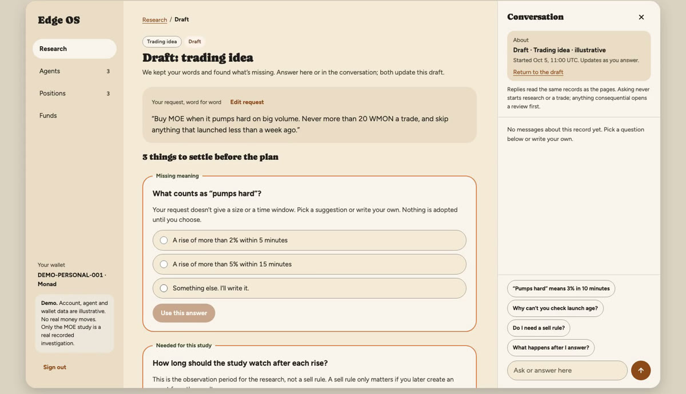
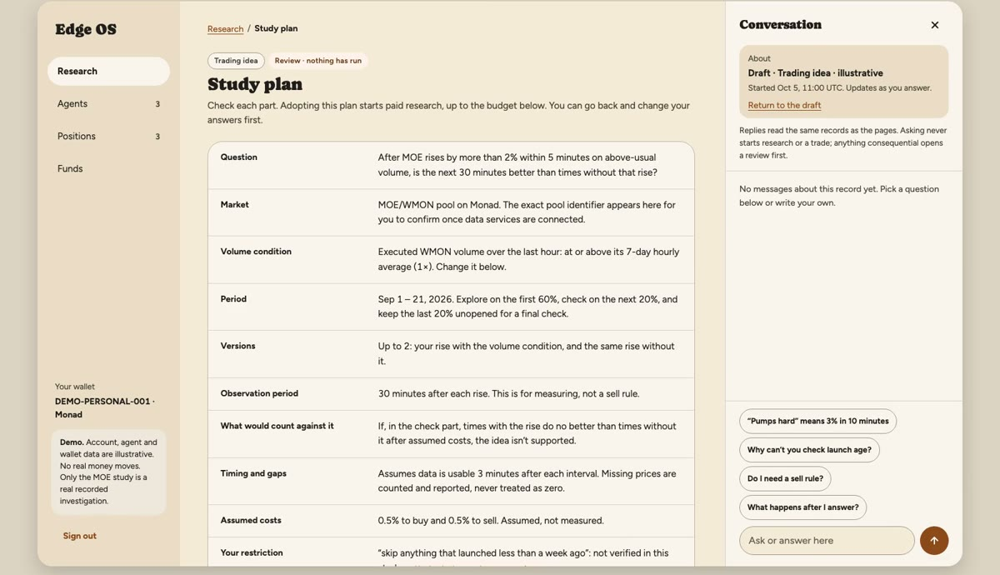
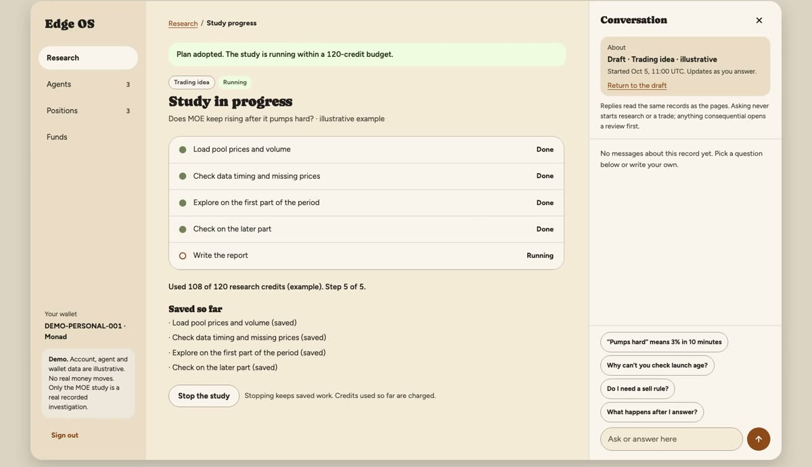
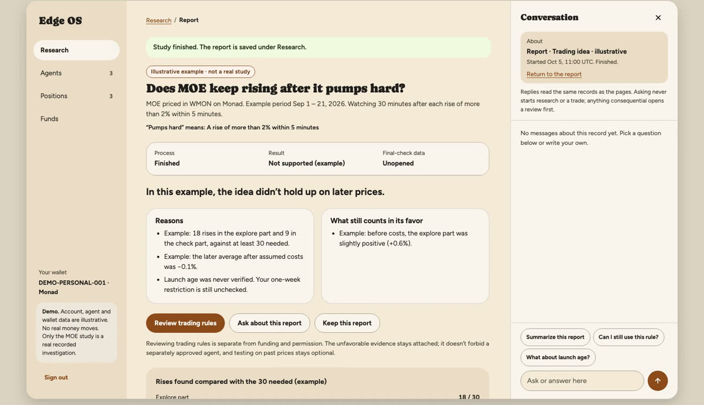
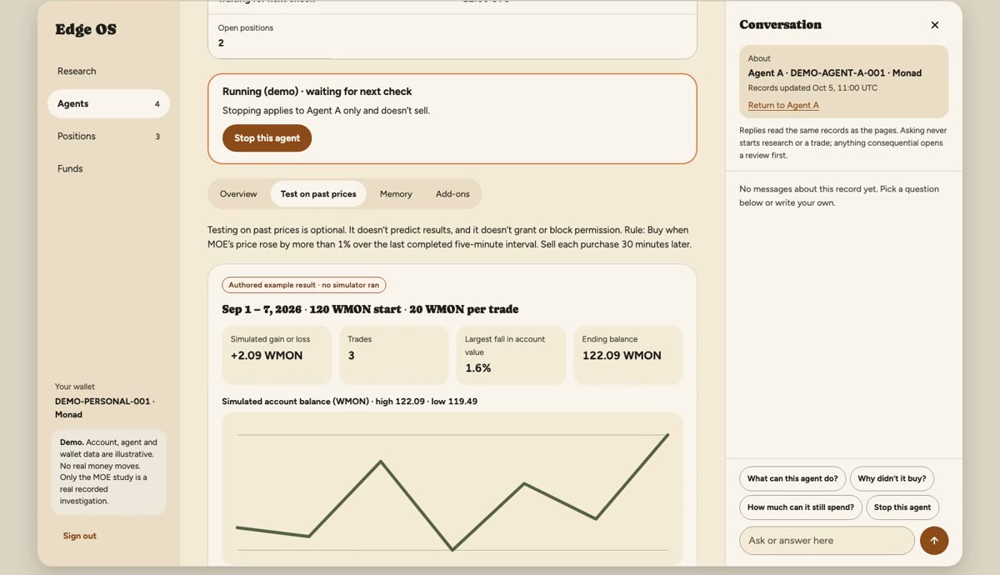
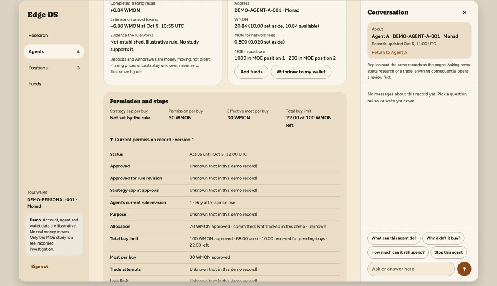
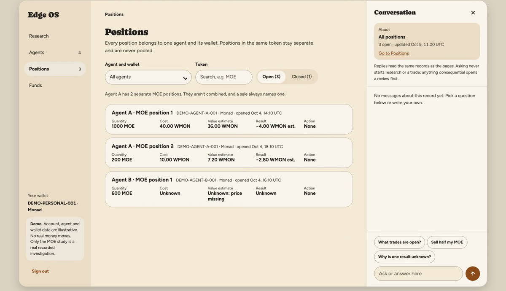
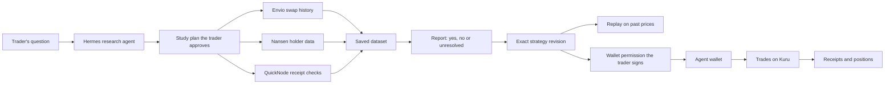

# Edge OS

**Ask a trading question in plain English. Find out if the idea holds before you risk money. Then let an agent trade it only inside limits you sign.**

Edge OS is a research and trading app for meme-token traders on Monad. A research agent checks your idea against on-chain history and saves what it found. Rules that hold up can be replayed on past prices. When you go live, an agent with its own wallet trades on Kuru, and the wallet permission you approved decides what it may do.

[Pitch video](https://vimeo.com/1235649955) · [Technical demo](https://vimeo.com/1235648532) · [Live app](https://edgeos.fun)

Built for the Monad hackathon, Onchain Finance & Trading track.

## The problem

A meme token on Monad jumps hard in five minutes. Do you buy?

Most traders guess. Some hand the guess to a bot that holds their keys. The research behind the guess is spread across a chart, a social feed, a wallet explorer, a notebook and the trading venue. By the time a trade happens, the original question is gone, the evidence against the idea was never written down, and nobody can say why the trade was made.

The tools that try to help make it worse in quieter ways:

- A backtest can look great because it ignores spread, slippage and fees, or because someone tried many variants and kept the best one.
- A model can turn "buy when it pumps" into precise-looking rules that mean something the trader never said.
- A bot that executes a trade does not prove the idea had an edge. It only proves the bot had the keys.

The cost is a trade on a false edge, a round trip, or a wallet emptied by a rule nobody checked.

## What Edge OS does

1. **It checks the idea before you trade it.** You describe a hunch, a thesis or a question about a market. A Hermes research agent asks what it needs to know, proposes a study with a fixed scope and budget, collects the data, and saves a report. The report shows supporting evidence, contrary evidence and what is missing. It is allowed to say no.
2. **It turns an idea that holds into exact rules.** Supported rules compile into a strategy revision that cannot change after you save it. You can replay it on past prices and see trades, costs, gains, losses and drawdown, with every assumed fill labelled.
3. **It trades only inside the limits you approve.** Each agent gets its own Privy wallet, linked to yours. You approve one strategy revision with its tokens, size, spending limit, expiry and stop rules. The agent trades on Kuru inside that permission, and you can stop it at any time. A good report or a good backtest never grants trading permission by itself.

## A walkthrough

The example below uses the MOE token on Monad. The numbers in it are illustrative.

**1. Ask in plain English.** A trader writes: "Buy MOE when it pumps hard on big volume. Never more than 20 WMON a trade, and skip anything that launched less than a week ago." Edge OS keeps those words exactly as written. The agent asks only what it needs, such as what "pumps hard" means and how long to watch after each rise. Nothing it suggests is adopted until the trader chooses it.



**2. Review the study plan.** The trader sees the market, time window, question, rule and research budget before any data is read.



**3. Let the agent investigate.** The research agent pulls swap history from Envio, checks transaction receipts through QuickNode, and adds holder and flow data from Nansen. Every variant it tries is recorded, so a failed attempt cannot disappear from the result. The trader can stop the study at any point and keep what is already saved.



**4. Read the report.** In this example, the idea does not hold up on later prices. The report says so, shows why, and keeps what still counts in the idea's favor. The trader learns this before placing a trade.



**5. Replay the rules.** When an idea does hold, the trader reviews the exact rules beside a plain-English summary, then tests them on past prices with a starting balance, trade size and costs they choose.



**6. Go live.** The trader creates an agent, funds its wallet, and reviews one permission: which strategy revision, which tokens, how much per trade, the total limit, when it expires and when it stops. After one approval, routine trades run without the trader online.



**7. Inspect and stop.** Agents, Positions and Funds show every trade, receipt and holding by agent and wallet. Chat answers questions from the same records. Stopping an agent, selling a position and removing its permission are separate controls, each explained before you use it.



## How each sponsor tool is used

| Tool | What it does in Edge OS | Source |
| --- | --- | --- |
| Envio HyperSync | Supplies Monad swap history for the market and time window in each study. | [History collection](apps/api/src/edge_os_api/research/native_history_collection.py) |
| Nansen | Adds holder and token-flow data to the report. Holder data describes who holds a token. It does not prove that a wallet made money. | [Nansen collector](apps/api/src/edge_os_api/nansen_research/collector.py) |
| Privy | Signs the trader in and gives each agent its own wallet, linked to the owner. Removing the agent's signer leaves the owner in control of the funds. | [Privy setup](apps/web/lib/privy-config.ts) |
| Kuru | Executes the agent's spot trades on Monad. Edge OS checks each route against the approved permission before signing and saves the receipt. | [Trade preparation](apps/api/src/edge_os_api/kuru_flow/transaction_preparation.py) |

## How it works



Two more tools do important work outside the sponsor list:

- **Hermes** runs the research agent. It interprets the trader's request, plans the study and writes the report. It runs in a sandbox with no API key and no internet access, and it cannot grant trading permission or submit a transaction. See the [interpreter](apps/api/src/edge_os_api/research/hermes_interpreter.py).
- **QuickNode** confirms the chain and checks a sample of transaction receipts against the Envio history. See the [receipt checks](apps/api/src/edge_os_api/research_history/quicknode_corroboration.py).

The research side and the trading side meet in one place, the permission the trader signs. Everything left of it can read data and write reports. Only an agent holding a signed permission can trade.

A few design rules hold the system together:

- **The model proposes, code decides.** Hermes writes the study and the report. A typed rule compiler, a risk check and the wallet's signing policy decide what an agent may do. A model output cannot widen a permission.
- **A strategy cannot change under a permission.** Each saved revision is fixed. Editing the rules creates a new revision, which needs a new approval.
- **The research market and the trading route are separate.** A study about a pool does not imply that Kuru can trade it. Edge OS checks the route before an agent can use it.
- **An uncertain trade is never retried blindly.** If a transaction's result is unknown, Edge OS keeps the original attempt and checks it against on-chain receipts before anything else is sent.
- **Every wallet is separate.** One agent's pending trade cannot use or block another agent's funds.

The [architecture guide](docs/architecture/README.md) covers services, jobs, records and recovery in more detail.

## Bugs that shaped the design

The rule I kept coming back to: a result is only useful if it cannot quietly lie. These are real bugs from this repository. Each one could have made a result look better or safer than it was.

- **The replay could peek at the answer key.** Each study keeps its last part of the data back as a final check. A replay window could run past that point, and a five-minute bucket ending exactly on the boundary was counted on the wrong side. That leaks future data into the test. Replays now stop before the held-back data, buckets count only the time they cover, and a study with a missing plan protects its whole window. Fixed in [f4fc208](https://github.com/edge-os-app/edge-os/commit/f4fc208) and [8cc0e57](https://github.com/edge-os-app/edge-os/commit/8cc0e57).
- **"Below -2%" was treated as a misreading.** When a trader wrote a negative threshold, the check that every number comes from the trader's own words could not find the minus sign, so a correct interpretation was rejected every time. Hostile model output could also crash the parser and leave the attempt stuck. The check now reads "-2%", "minus 2%" and "negative 2 percent", and bad model output becomes a clean rejection. Fixed in [c2b64bc](https://github.com/edge-os-app/edge-os/commit/c2b64bc).
- **One broken log line could close a half-known trade.** If a swap receipt had one malformed log, the code still added up the valid parts and released the reserved funds. That records a partial amount as the whole trade. Now any malformed log makes the amounts unknown, the reservation stays in place, and expiry is checked again before signing and before sending. Fixed in [dac088a](https://github.com/edge-os-app/edge-os/commit/dac088a) and [74f59ef](https://github.com/edge-os-app/edge-os/commit/74f59ef).
- **`true` matched request 1.** In Python, `True == 1`, so an RPC reply with `"id": true` was accepted as the answer to request 1. The client now requires an integer ID that equals the one it sent. The same fix stopped provider error text from reaching users and made the deadline cover the whole call. Fixed in [9d9d815](https://github.com/edge-os-app/edge-os/commit/9d9d815).

## Roadmap

Edge OS starts with one job done well: short-term momentum and reversal ideas on Monad meme-token spot markets, traded on Kuru.

| Stage | What ships |
| --- | --- |
| Hackathon release | Research agent with Envio, QuickNode and Nansen data. Saved reports that can say no. Exact strategy rules with a plain-English summary. Replay on past prices. One Privy wallet per agent. Signed trading permissions with limits, expiry and stops. Agents that trade on Kuru while you are offline. Agents, Positions and Funds views, with chat over the same records. |
| Next | A small catalog of research add-ons you can switch on per agent. Wider data coverage and more strategy templates, guided by trader sessions. |
| After that | Liquidity providers. The same research, rules and replay for questions about pool fees, inventory and rebalancing. Live LP management once the spot path is stable. |

Edge OS will not offer copy trading, a strategy marketplace, perpetuals, cross-chain trading or any promise of profit.

## Run it locally

The [local runbook](deploy/local/RUNBOOK.md) lists the required Python, Node.js and Docker versions, the settings, and the command order. The local profile uses test data and has no route to outside services. The API reads environment variables directly and does not load `.env` files.

On 16 October 2026, 2,845 API tests and 253 web tests passed on `main`. Run them yourself:

```bash
cd apps/api && uv run pytest    # API, Python 3.14
cd apps/web && npm test         # web app, Vitest
```

## Project documents

- [Architecture guide](docs/architecture/README.md): how the parts fit together, with links to the code
- [Design decisions](docs/adr/): eight short records of the main technical choices
- [Local runbook](deploy/local/RUNBOOK.md): settings and commands to run Edge OS on your machine

## Team

Edge OS is built by David ([@degencodebeast](https://github.com/degencodebeast)), solo founder.
