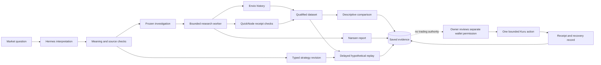

# Edge OS

**Turn a Monad market question into research you can inspect, save, and revisit.**

A chart shows that a token moved. It does not show the source coverage, the rule behind the signal, or the data missing from the review.

Edge OS keeps the question, source evidence, rule choices, and result in one saved trail. It helps Monad spot traders decide whether an idea deserves more work. An investigation can reject the idea. Research and a simulated result never grant permission to trade.

The demo stays on Monad spot and uses Kuru for its one action. This narrow scope binds the question, history, strategy, and permission to the same chain and venue.

## One question, one inspectable path

For example, a trader asks: "When a Monad token makes a sharp move and quote volume rises, what happens next?" The example is illustrative.

1. **Describe the question.** Hermes turns the trader's words into structured fields. The app checks quoted facts and numbers against the request. Proposed settings stay pending until the trader adopts them.
2. **Set the investigation.** The trader reviews the market, time window, hypothesis, rule, and collection bounds before the worker reads outcomes.
3. **Collect and inspect evidence.** Envio supplies indexed swap history. QuickNode checks chain identity and sampled receipts. Nansen adds a bounded holder and flow report. The saved dataset keeps source coverage, gaps, availability, and raw evidence beside normalized records.
4. **Write a supported rule.** A deterministic compiler accepts a limited price-and-volume language. Each saved strategy revision binds the exact rule and its semantic manifest.
5. **Replay with a delay.** The replay waits 300 seconds after a source bucket closes, then uses the next delayed historical close as a hypothetical fill. The app labels every fill as hypothetical. If the next close is late, empty, or unqualified, it records <code>FILL_UNAVAILABLE</code> instead of choosing another price.
6. **Review a separate action.** One owner signs in with Privy. The owner funds an agent wallet and reviews the exact strategy, wallet, limits, and expiry. A separate execution service prepares one bounded Kuru action on Monad and records its receipt or recovery state.

A saved investigation, strategy, dataset, and replay can be reopened by their original identity. Reopening reads the saved result. It does not collect new data or recalculate the replay.

## What each integration does

| Integration | Role in the demo | Source |
| --- | --- | --- |
| Hermes | Interprets the trader's request with bounded context. It cannot grant permission or submit a transaction. | [Interpreter](apps/api/src/edge_os_api/research/hermes_interpreter.py), [relay composition](apps/api/src/edge_os_api/research/hermes_relay_composition.py) |
| Envio HyperSync | Supplies indexed Monad swap history for the declared investigation. | [History collection](apps/api/src/edge_os_api/research/native_history_collection.py) |
| QuickNode | Checks the Monad chain identity and corroborates a declared sample of transaction receipts. | [Receipt checks](apps/api/src/edge_os_api/research_history/quicknode_corroboration.py) |
| Nansen | Supplies bounded holder and flow context in a saved descriptive report. Address inventory does not prove wallet profit or a trading edge. | [Nansen collector](apps/api/src/edge_os_api/nansen_research/collector.py), [saved reports](apps/api/src/edge_os_api/research/nansen_reports.py) |
| Privy | Identifies the owner at sign-in and provides the separate wallet and signing boundary. Sign-in alone creates no agent wallet and grants no trading authority. | [Web authentication](apps/web/lib/privy-config.ts), [API verification](apps/api/src/edge_os_api/core/authentication.py) |
| Kuru Flow on Monad | Supplies the selected spot route. The app checks route data against the exact action terms and keeps receipts with the original attempt. | [Route preparation](apps/api/src/edge_os_api/kuru_flow/transaction_preparation.py), [transaction journal](apps/api/src/edge_os_api/execution/original_transaction.py) |

## Keep evidence and permission separate

The research report shows what the evidence supports and what its sources do not cover. It keeps collection times, source gaps, and contrary findings visible. A comparison can remain unresolved.

Source records show what each request covered and when each observation became available. Missing delivery evidence stays missing. A qualified receipt sample does not prove every source claim.

The compiler accepts supported typed rules over price and quote volume. It does not run model-generated Python or smart contracts. It binds each saved strategy to a versioned meaning, so the same rule keeps the same interpretation when the trader reopens it.

Replay binds the exact strategy, dataset, market, window, and run configuration. Its fills are assumptions over past prices. They are not executable quotes or predictions of future profit. The numerical model uses saved fee and slippage assumptions. It omits gas, spread, added price impact, and capacity.

The owner reviews wallet, strategy revision, allocation, allowances, gas, permitted actions, and expiry separately from research. The executor checks the route and current permission before signing. A research result or a favorable replay cannot activate a wallet.

When an action result is uncertain, Edge OS marks it <code>UNKNOWN</code>, keeps its reservations, and reconciles the original attempt from server-side receipt evidence. It does not submit a replacement transaction automatically. A stop blocks selected unsent work. Removing signer access prevents new submissions, but it does not undo a broadcast transaction or sell remaining holdings.

## Inspect a saved result

Start with the original request and adopted fields. Follow its declaration to the dataset and report. Check the source window, coverage, gaps, and contrary findings before reading the comparison.

Open the exact strategy revision and replay configuration next. Confirm that each fill is hypothetical and tied to the saved historical close. Then inspect the separate wallet permission and the action's original attempt and receipt record.

## Architecture

Solid paths show how the demo carries evidence. The dotted link marks the separate permission review. See the [architecture explanation](docs/architecture/README.md) for the service map, durable job flow, records, recovery, spending boundaries, and source map.

## Run the local fixture

The [local Docker runbook](deploy/local/RUNBOOK.md) gives the required settings and command order. It uses synthetic identity and fixture providers. Its application network has no route to external services, so it is a local rehearsal profile, not a live provider setup.

The API reads explicit environment variables and does not load <code>.env</code> files by itself. The runbook lists the supported Python, Node.js, and Docker requirements.

## Scope and project links

The demo covers Monad spot research and one bounded Kuru action. Recurring trading, LP strategies, and additional exchanges remain later work.

- [Product specification](docs/superpowers/specs/2026-09-29-edge-os-hackathon-design.md)
- [Research contracts](docs/EDGE_OS_RESEARCH_CONTRACTS.md)
- [Delayed replay profile](docs/implementation/DELAYED_HISTORY_REPLAY_PROFILE.md)
- [Local fixture runbook](deploy/local/RUNBOOK.md)
- [Contributor workflow](docs/agents/contributor-workflow.md)
- [Agent instructions](AGENTS.md)
- [GitHub issue tracker](https://github.com/edge-os-app/edge-os/issues)
