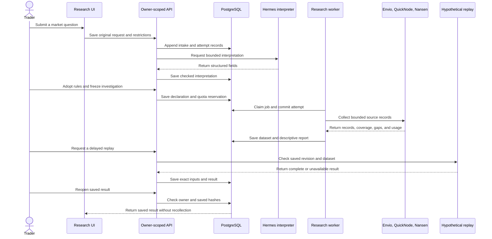

# Why Edge OS separates research from execution

A market question starts with uncertain meaning and incomplete evidence. A trading action needs exact rules, current permission, and a recoverable transaction record. Edge OS stores these as connected records with separate authority.

This page follows one Monad spot idea from the browser through research, replay, and one separately approved Kuru action. It explains which records bind the steps and what the user can recover after a failure.

## Follow the research path

The request preserves the trader's original words and restrictions. The interpretation adds candidate fields with their source, uncertainty, and adoption state. A proposal remains pending until the trader adopts it. The router can ask a question, reject an unsupported request, keep an unresolved result, or produce a draft for the compiler.

The API saves a request before it calls Hermes. A saved attempt identifies the prompt, response shape, model configuration, and request. If the worker cannot confirm the attempt result, it keeps the outcome unknown. It does not silently repeat a provider call after restart.

## Compile exact, supported rules

The compiler accepts JSON expression trees over spot price and quote volume. Its supported operators include returns, relative volume, lag, sums, means, comparisons, and Boolean combinations. It checks units, the market, a five-minute schedule, required history, sizing, and finite work. It rejects unsupported operators and arbitrary generated code.

Compilation requires execution permission to remain <code>NOT_GRANTED</code>. Publication compares canonical strategy bytes with the saved draft and expected parent revision. Each immutable revision stores the canonical content, a content hash, and a semantic manifest hash. The manifest fixes the strategy language and calculation meaning.

A research report therefore cannot grant permission to spend. A trader must review and adopt the exact rule revision before it can feed a later workflow.

## Follow each typed record

Each record carries a distinct part of the lineage.

| Record | What it preserves |
| --- | --- |
| <code>IntakeRequest</code> | The original words, restrictions, requested job, and input class. |
| <code>FieldEvidence</code> | Each field's state, origin, source, uncertainty, adoption, and conflicts. |
| Investigation declaration | The hypothesis, rule map, field origins, trial and evaluation identities, source profile, time range, limits, and first-access order. |
| Dataset and research report | Raw evidence, normalized buckets, coverage, gaps, availability, provenance, contrary findings, and source identities. |
| <code>StrategySpec</code> and revision | The typed rule, exact market and timing, canonical content, and semantic manifest. |
| Saved replay | The strategy revision, dataset, run configuration, result, and content hash. |
| Wallet and action records | The owner, agent, wallet, strategy revision, consent terms, attempt identity, reservations, receipt evidence, and recovery state. |

The seven-field research envelope supplies the record type, owner, operation, and creation identity. The database adds lineage and sequence fields. The [P02 contract](../contracts/p02/contract.json) defines the exported shape.

## Freeze the question before collecting outcomes

An investigation declaration binds the original request to its hypothesis and rule map. It also records field origins, trial and evaluation IDs, source profile, time range, and collection limits. It starts before outcome labels are read. The worker stores that order so the report can show what the investigator could see.

A job reserves owner and global request and compute limits before collection. PostgreSQL locks one job against concurrent workers. Before a provider effect, the worker rechecks the frozen source, records <code>ATTEMPT_STARTED</code>, and commits it.

Envio HyperSync supplies indexed swap history. QuickNode checks the Monad chain ID and corroborates a declared sample against transaction receipts. The normalizer converts source records into five-minute buckets with coverage, gaps, availability, and claim-level results. A complete empty bucket has zero volume and no close price.

The saved dataset keeps raw source records beside normalized buckets, query identities, evidence class, qualification, and hashes. A sample does not establish every claim. Missing delivery evidence stays missing. Only complete, overall <code>QUALIFIED</code> history can produce a market binding.

The comparison reads training and descriptive partitions. It does not read validation or holdout outcomes. Its report saves contrary findings, source order, and its dataset and rule identities. A descriptive result does not establish statistical support.

Nansen collects bounded holder and flow records through a separate job. Its deterministic report uses a keyword map to limit which parts of the question its evidence can answer. An address list does not establish unique people, purchases, profit, concentration, or a trading edge. The saved report links the request, evidence, report, hashes, response references, and settlement.

## Read a saved replay as a hypothesis

Each replay binds an exact strategy revision, dataset, market, time window, starting account, and run-configuration ID. It checks hashes, source qualification, coverage, warm-up, protected partitions, and when each observation became available. Reusing the same request key returns the saved result. Different inputs under that key conflict. The app saves explained <code>UNAVAILABLE</code> outcomes as well as complete results.

The demo uses a fixed 300-second delay after each source bucket closes. A decision uses evidence available at that delayed time. A hypothetical fill uses the next delayed historical close and saved fee and slippage assumptions. The result labels each fill as hypothetical. It does not treat a historical close as a current quote.

If the next close is late, unknown, unqualified, or empty, the replay records <code>FILL_UNAVAILABLE</code>. It does not substitute an earlier or later price, extend the window, or retry the fill. The replay omits gas, spread, added price impact, and capacity. Those limits remain visible with the result.

## Keep owner identity separate from wallet authority

Privy sign-in supplies an access token. The API checks its signature, issuer, audience, expiry, and subject, then maps the Privy DID to an internal owner. API reads use that verified owner. A foreign owner's record returns 404. Login creates no agent wallet.

Wallet setup binds an owner and agent to an exact strategy revision, network, and returned wallet identity. It saves dispatch intent before wallet creation. Binding requires an independent lookup of the exact wallet ID, owner, chain type, and address. If the response is lost and no exact wallet ID is known, recovery stays <code>UNKNOWN</code>. It never selects the newest wallet or repeats creation.

Funding and consent are separate records. Funding credits only confirmed server observations. Consent binds an exact wallet and revision to the allocation, cumulative allowances, gas limit, allowed actions, and expiry. A deposit does not activate trading or reset allowances.

The owner reviews this permission separately from the research report. Each agent uses its own wallet. An account summary combines records; it does not combine spending authority.

## Journal one action and recover its original attempt

An action request creates a saved job. The worker checks the exact owner, wallet, strategy, current observation, and permission. The admission service reserves capital, gas, allowances, and attributed inventory under per-wallet locks. The bounded action allows one open or pending position per wallet and network.

The executor validates the supplied Kuru Flow route against the approved network, token addresses, recipient, input, minimum output, fees, allowance, and expiry. Privy signs under wallet-specific restrictions. The executor has no login token and cannot change wallet policy.

The transaction engine records preparation, signing intent, signed bytes, and broadcast intent in order. Before signing and broadcast, it checks current stops and expiry. It broadcasts the original signed bytes once. It does not requote, choose a new nonce, or sign again after an uncertain result.

The application reconciles from server-side receipt evidence for the original attempt. An uncertain outcome remains <code>UNKNOWN</code>. Reservations and the exclusive action claim stay in place. The system does not send a replacement transaction. A stop blocks selected unsent work. Removing signer access blocks new submissions. Neither control cancels a broadcast action or sells remaining holdings.

These states give the owner a specific recovery path. Inspect the attempt and its receipt evidence. Reconcile that same attempt before requesting a new action.

## Keep provider spending bounded

Hermes interpretation uses a provider relay. The API records and reserves worst-case model liability before a send. The model job has no provider key or network access. A credential-bearing relay accepts a signed bounded grant and sends through a keyless gateway to a fixed destination. TLS continues from the relay to the provider.

A valid usage record settles the model reservation. Missing or invalid usage keeps the liability <code>UNKNOWN</code>. A started relay request does not run again after restart. Accepted interpretation text can be reparsed without another provider request.

Research quotas track requests, compute, and Nansen credits in separate units. Unknown usage keeps its reservation. These ledgers do not automatically reconcile outside spending or provider invoices.

## Where to inspect the implementation

| Responsibility | Source |
| --- | --- |
| Browser screens and authenticated requests | [Web components](../../apps/web/components/), [auth](../../apps/web/lib/auth.tsx), [API client](../../apps/web/lib/api.ts) |
| API composition and identity | [Application factory](../../apps/api/src/edge_os_api/main.py), [authentication](../../apps/api/src/edge_os_api/core/authentication.py) |
| Record validation and research lineage | [Record models](../../apps/api/src/edge_os_api/records/models.py), [research service](../../apps/api/src/edge_os_api/research/service.py), [interpretation checks](../../apps/api/src/edge_os_api/research/interpretation_response.py) |
| History, comparison, and Nansen reports | [Investigation jobs](../../apps/api/src/edge_os_api/research/investigation_jobs.py), [history normalization](../../apps/api/src/edge_os_api/research_history/history_normalizer.py), [Nansen reports](../../apps/api/src/edge_os_api/research/nansen_reports.py) |
| Strategy and replay | [Compiler](../../apps/api/src/edge_os_api/strategies/compiler.py), [saved replay](../../apps/api/src/edge_os_api/replay/saved_runs.py), [delayed replay profile](../implementation/DELAYED_HISTORY_REPLAY_PROFILE.md) |
| Wallet and execution records | [Wallet setup](../../apps/api/src/edge_os_api/wallet_setup/service.py), [consent](../../apps/api/src/edge_os_api/consent/service.py), [admission](../../apps/api/src/edge_os_api/admission/service.py), [transaction engine](../../apps/api/src/edge_os_api/execution/original_transaction.py), [recovery](../../apps/api/src/edge_os_api/recovery/service.py) |
| Provider relay and local fixture | [Hermes relay composition](../../apps/api/src/edge_os_api/research/hermes_relay_composition.py), [egress gateway](../../scripts/hermes_provider_relay/egress_gateway.py), [local runbook](../../deploy/local/RUNBOOK.md) |

The [P02 record contract](../contracts/p02/contract.json), [P06 compiler profile](../implementation/P06_COMPILER_PROFILE.md), [separate-wallet decision](../adr/0007-separate-user-owned-agent-wallets.md), and [execution boundary decision](../adr/0005-model-and-execution-authority-boundary.md) define the versioned interfaces and authority limits.
