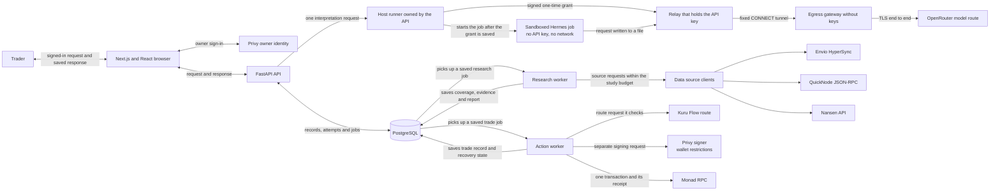
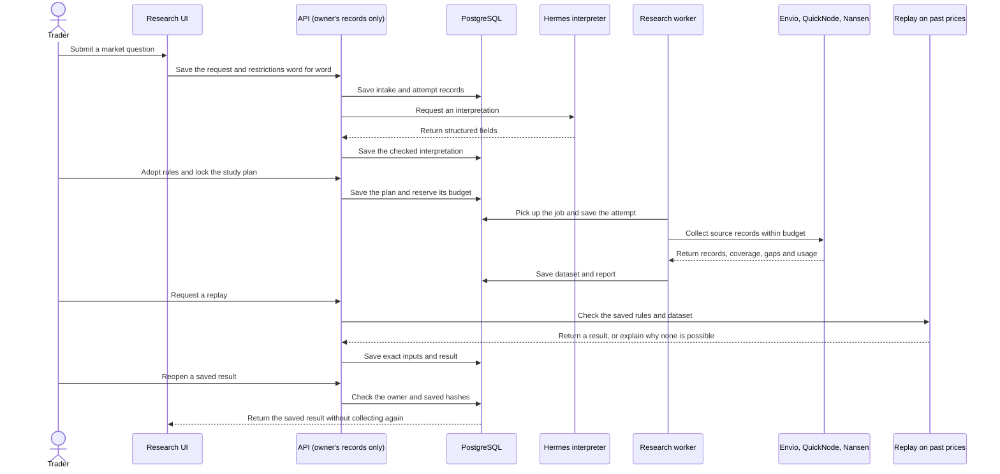
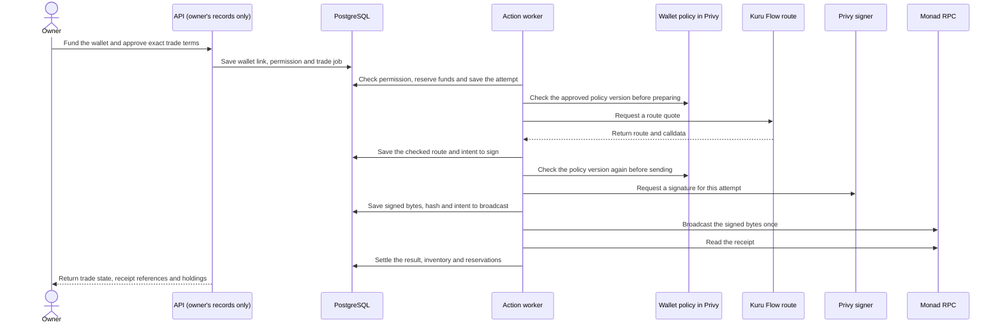

# How Edge OS works

A trading idea starts vague. A trade needs exact rules, a live permission and a record that survives a crash. Edge OS keeps these as separate records that point to each other, and only one of them can move money: the wallet permission the owner signs.

This guide follows one Monad spot idea from the browser through research, replay and live trading. An agent's first trade and its hundredth go through the same action path, described in [How a trade is recorded and recovered](#how-a-trade-is-recorded-and-recovered).

## System overview

The diagram shows each part of the system and what it is allowed to reach. It is not a deployment file.

The browser and API handle ordinary requests. A Hermes interpretation is one request that the API owns from start to finish. Research and trades are background jobs. The API saves each job in PostgreSQL, a separate worker picks it up, and the worker saves what it is about to do before it calls anything outside the system. So the browser can reopen any result without collecting data again or sending a transaction again.

| Part | What it does | Source |
| --- | --- | --- |
| Browser | Next.js 16.3.8 and React 19.3.0 show the research flow, sign the owner in with Privy and call the API. | [Web package](../../apps/web/package.json), [Privy setup](../../apps/web/lib/privy-config.ts), [API client](../../apps/web/lib/api.ts) |
| API | FastAPI 0.142.2 checks who the owner is, serves their reads and writes, runs interpretation requests and creates background jobs. | [API package](../../apps/api/pyproject.toml), [application factory](../../apps/api/src/edge_os_api/main.py), [owner verification](../../apps/api/src/edge_os_api/core/authentication.py), [settings](../../apps/api/src/edge_os_api/core/settings.py) |
| Saved records | PostgreSQL stores each owner's records, how they link, interpretation attempts, job state, reservations and trade records. | [Database setup](../../apps/api/src/edge_os_api/core/database.py), [record models](../../apps/api/src/edge_os_api/records/models.py), [migrations](../../apps/api/migrations/) |
| Research worker | Picks up locked study plans, collects the declared sources, checks the history is complete enough to use, writes reports, and records usage and gaps. | [Investigation worker](../../apps/api/src/edge_os_api/research/investigation_jobs.py), [worker loop](../../apps/api/src/edge_os_api/core/worker_loop.py) |
| Hermes sandbox | The model job has no API key and no network. A separate relay holds the key, and the gateway only lets traffic reach the pinned OpenRouter address. | [Hermes interpreter](../../apps/api/src/edge_os_api/research/hermes_interpreter.py), [relay composition](../../apps/api/src/edge_os_api/research/hermes_relay_composition.py), [relay runner](../../scripts/hermes_provider_relay/relay_turn_runner.py), [egress gateway](../../scripts/hermes_provider_relay/egress_gateway.py) |
| Data source clients | Envio supplies indexed swap history. QuickNode confirms the chain and checks a sample of receipts. Nansen supplies holder and flow data. | [History clients](../../apps/api/src/edge_os_api/research/native_history_collection.py), [QuickNode checks](../../apps/api/src/edge_os_api/research_history/quicknode_corroboration.py), [Nansen collector](../../apps/api/src/edge_os_api/nansen_research/collector.py) |
| Action worker | Picks up a saved trade job, checks the permission and inputs, reserves funds and limits, and takes the transaction through to a known result. | [Action worker](../../apps/api/src/edge_os_api/execution/worker.py), [admission](../../apps/api/src/edge_os_api/admission/service.py), [transaction record](../../apps/api/src/edge_os_api/execution/original_transaction.py) |
| Route, signer and chain | Kuru provides the route. A separate Privy signer signs only what the wallet's restrictions allow. Monad RPC carries the transaction and returns the receipt. | [Kuru preparation](../../apps/api/src/edge_os_api/kuru_flow/transaction_preparation.py), [Privy signer](../../apps/api/src/edge_os_api/execution/privy_signer.py), [transaction path](../../apps/api/src/edge_os_api/execution/original_transaction.py) |

**How the model is kept away from secrets.** The model runs in a sandbox with no API key and no internet access. When it needs to call OpenRouter, it writes the request to a file. A separate relay holds the key and forwards the request only if it matches a one-time grant the API signed. The API checks the saved budget reservation, saves the grant, and only then starts the job. The job never sees the grant or the key.

The API checks owner tokens with the Privy app ID and public verification key. It refuses to start if given a Privy app secret, and it does not load `.env` files. Signing runs in a separate service that never receives a browser login token and cannot change wallet policy. Each data source's credentials are read only after a release defined in code approves that source, its endpoint and its limits.

## The research path

Edge OS keeps the trader's words and restrictions exactly as written. Hermes proposes fields, and each one records where it came from, how sure it is, and whether the trader adopted it. Nothing Hermes suggests takes effect until the trader adopts it. From there, the app can ask a question, reject a request it cannot support, keep an unresolved result, or pass a draft to the compiler.

The API saves each request before it calls Hermes. The saved attempt names the prompt, the expected response shape, the model settings and the request. If a worker restarts and cannot confirm what happened to a call, the result stays unknown. The worker does not quietly call the model again.

## Exact rules, checked by a compiler

Strategies are JSON expression trees over spot price and quote volume. The compiler supports returns, relative volume, lag, sums, means, comparisons and Boolean logic. It checks units, the market, a five-minute schedule, how much history is needed, trade sizing, and that the work is finite. It rejects anything else, including code a model writes.

Compiling a strategy never grants permission to trade. Its permission field must stay `NOT_GRANTED`. When a strategy is published, the app compares its exact bytes with the saved draft and the expected parent version. Each revision is fixed once saved. It stores its content, a content hash, and a hash of the rule language and calculation meaning, so an old result cannot be reused for a rule that now behaves differently.

The trader must review and adopt an exact rule revision before anything later can use it.

## The records and what each keeps

Each record keeps one part of the history from question to trade.

| Record | What it keeps |
| --- | --- |
| `IntakeRequest` | The trader's words, restrictions, requested job and input type. |
| `FieldEvidence` | For each field: its state, origin, source, uncertainty, whether it was adopted, and any conflicts. |
| Study plan (investigation declaration) | The hypothesis, rule map, where each field came from, trial and evaluation IDs, sources, time range, limits, and the order in which data was first read. |
| Dataset and research report | Raw evidence, five-minute buckets, coverage, gaps, when data became available, sources, and contrary findings. |
| `StrategySpec` and revision | The typed rule, exact market and timing, its content, and the hash of its rule meaning. |
| Saved replay | The strategy revision, dataset, run settings, result and content hash. |
| Wallet and trade records | The owner, agent, wallet, strategy revision, consent terms, attempt ID, reservations, receipt evidence and recovery state. |

Every research record shares a seven-field header with its type, owner, operation and creation ID. The database adds link and sequence fields. The [P02 contract](../contracts/p02/contract.json) defines the exported shape.

## The study plan is locked before data is read

The study plan ties the trader's request to a hypothesis and a rule map. It also records where each field came from, the trial and evaluation IDs, the sources, the time range and the collection limits. It is saved before any outcome data is read, and the worker records that order, so the report can show exactly what the researcher could see at each point.

Before collecting, a job reserves the owner's share and the system-wide share of requests and compute. PostgreSQL locks the job so only one worker runs it. Before calling a data source, the worker checks the plan has not changed, then saves and commits `ATTEMPT_STARTED`.

Envio HyperSync supplies indexed swap history. QuickNode confirms the Monad chain ID and checks a declared sample of transactions against their receipts. The normalizer turns source records into five-minute buckets, each with its coverage, gaps and the time its data became available. A bucket with no trades has zero volume and no close price.

The saved dataset keeps raw source records next to the buckets, along with the queries, evidence type, quality status and hashes. A checked sample does not prove every record. Data that never arrived stays marked as missing. Only history that passes every check (`QUALIFIED`) can be used to tie a study to a market.

The comparison reads only the training and descriptive parts of the data. It never reads the validation or holdout parts. The report saves contrary findings, the order sources were read, and the dataset and rule IDs. A descriptive result is not a statistical proof.

Nansen holder and flow data comes from a separate job with its own credit budget. Its report uses a keyword map to limit which parts of the question that data can answer. A list of addresses does not show how many people there are, what they bought, whether they made money, or whether there is an edge. The saved report links the request, evidence, report, hashes, response references and the final credit charge.

## What a replay result means

A replay is a test of rules against the past, not a forecast. Each one is tied to an exact strategy revision, dataset, market, time window, starting balance and run settings. It checks hashes, data quality, coverage, warm-up, the protected holdout data, and when each data point became available. Sending the same request again returns the saved result. Sending different inputs under the same request key is rejected. When a replay cannot run, the app saves the reason as an `UNAVAILABLE` result.

Decisions wait 300 seconds after each five-minute bucket closes, and use only data available by then. A simulated fill uses the next delayed close, plus saved fee and slippage assumptions, and every fill is labelled as simulated. A past close is never treated as a price you could trade at now.

If the next close is late, unknown, fails quality checks, or has no trades, the replay records `FILL_UNAVAILABLE`. It does not pick an earlier or later price, stretch the window, or try again. The replay leaves out gas, spread, extra price impact and size limits, and shows that next to the result.

## Signing in is not permission to trade

Privy sign-in returns an access token. The API checks its signature, issuer, audience, expiry and subject, then maps the Privy ID to an internal owner. Every API read uses that owner, and a record that belongs to someone else returns 404. Signing in creates no agent wallet and gives no one the right to sign trades.

Creating an agent wallet links the owner and agent to an exact strategy revision, network and wallet. The app saves its intent before it asks Privy to create the wallet. It then looks up the exact wallet ID, owner, chain type and address on its own before linking them. If Privy's response is lost and the wallet ID is unknown, the wallet's state stays `UNKNOWN`. The app does not guess by picking the newest wallet, and it does not create a second one.

Funding and permission are separate records. Funding counts only deposits the server has confirmed on chain. Permission (consent) ties an exact wallet and strategy revision to an allocation, total spending limits, a gas limit, the allowed actions and an expiry. A deposit does not start trading or reset any limit.

**Two separate checks guard every trade.** First, Edge OS checks the trade in code: owner, wallet, network, strategy, funds, fresh data, a qualified Kuru route with enough liquidity to exit, and an active permission. Second, the wallet itself carries restrictions in Privy: the allowed network, contract, signing method, function and argument limits. The app checks that the wallet's policy version still matches the approved one before preparing a trade and again before sending it. If the app cannot confirm that a required restriction is in force, it marks it `UNKNOWN` and refuses the trade. The service that sends trades cannot edit wallet policy. See [the two enforcement layers](../superpowers/specs/2026-09-29-edge-os-hackathon-design.md#two-enforcement-layers) in the spec.

The owner reviews the permission separately from the research report. Each agent has its own wallet. The account summary adds up balances for display only. It does not pool spending between agents.

## How a trade is recorded and recovered

Every agent trade follows this path.

A trade request becomes a saved job. The worker checks the exact owner, wallet, strategy, latest market data and permission. The admission service then reserves capital, gas, spending allowance and the position's inventory, with a lock per wallet. In the current release, each wallet holds at most one open or pending position per network.

The executor checks the Kuru Flow route against the approved network, ERC-20 tokens, recipient, input amount, minimum output, route, fees, allowance and expiry. Native MON pays for gas and is never traded. Privy signs the transaction under the wallet's restrictions. The executor never receives a login token and cannot change wallet policy.

**Every trade is written down before it is sent.** The transaction engine saves preparation, the intent to sign, the signed bytes and the intent to broadcast, in that order. Just before signing and just before broadcasting, it checks for stops and expiry. It broadcasts the signed bytes once. If the result is unclear, it does not ask for a new quote, pick a new nonce or sign again.

The app then works out what happened from receipt evidence on the server for that same transaction. An unclear result stays `UNKNOWN`, and its reservations and lock stay in place. The app never sends a replacement transaction. A stop blocks trades that have not been sent. Removing the signer blocks new trades. Neither one cancels a trade already broadcast, and neither sells what the wallet holds.

This gives the owner a clear recovery path: look at the attempt and its receipt evidence, and settle that same attempt before asking for a new trade.

If a response is unclear, the worker checks receipt evidence for that same attempt and does not sign or broadcast a replacement. Reservations and the lock stay in place until the outcome is known, or until the app proves the trade was refused before it was broadcast.

## Limits on paid data and model calls

Before each Hermes call, the API saves and reserves the most the call could cost. The model job has no API key and no network. The relay that holds the key accepts only a signed grant for that one call, and sends it through a gateway without keys to one fixed address. TLS runs from the relay to the provider.

A data source can run only under a release defined in code with an approved ID. The app checks that release before it reads the source's credentials or opens a connection. The Hermes release pins the OpenRouter address, model route, request format, job image and price list. Request data and environment settings cannot add a source or change the route. Having a credential is not enough to call a provider.

A valid usage record settles the model reservation. If usage is missing or invalid, the cost stays `UNKNOWN`. A relay request that already started is not sent again after a restart. Saved model output can be parsed again without another paid call.

Research budgets track requests, compute and Nansen credits in separate units. Usage the app cannot confirm keeps its reservation. These budgets are not matched automatically against spending outside Edge OS or provider invoices.

## Where to find the code

| Area | Source |
| --- | --- |
| Browser screens and signed-in requests | [Web components](../../apps/web/components/), [auth](../../apps/web/lib/auth.tsx), [API client](../../apps/web/lib/api.ts) |
| API setup and owner identity | [Application factory](../../apps/api/src/edge_os_api/main.py), [authentication](../../apps/api/src/edge_os_api/core/authentication.py) |
| Record checks and research history | [Record models](../../apps/api/src/edge_os_api/records/models.py), [research service](../../apps/api/src/edge_os_api/research/service.py), [interpretation checks](../../apps/api/src/edge_os_api/research/interpretation_response.py) |
| History, comparison and Nansen reports | [Investigation jobs](../../apps/api/src/edge_os_api/research/investigation_jobs.py), [history normalization](../../apps/api/src/edge_os_api/research_history/history_normalizer.py), [Nansen reports](../../apps/api/src/edge_os_api/research/nansen_reports.py) |
| Strategy and replay | [Compiler](../../apps/api/src/edge_os_api/strategies/compiler.py), [saved replay](../../apps/api/src/edge_os_api/replay/saved_runs.py), [delayed replay profile](../implementation/DELAYED_HISTORY_REPLAY_PROFILE.md) |
| Wallets and trades | [Wallet setup](../../apps/api/src/edge_os_api/wallet_setup/service.py), [consent](../../apps/api/src/edge_os_api/consent/service.py), [admission](../../apps/api/src/edge_os_api/admission/service.py), [transaction engine](../../apps/api/src/edge_os_api/execution/original_transaction.py), [recovery](../../apps/api/src/edge_os_api/recovery/service.py) |
| Model relay and local setup | [Hermes relay composition](../../apps/api/src/edge_os_api/research/hermes_relay_composition.py), [egress gateway](../../scripts/hermes_provider_relay/egress_gateway.py), [local runbook](../../deploy/local/RUNBOOK.md) |

The [P02 record contract](../contracts/p02/contract.json), [P06 compiler profile](../implementation/P06_COMPILER_PROFILE.md), [separate-wallet decision](../adr/0007-separate-user-owned-agent-wallets.md) and [model and execution limits decision](../adr/0005-model-and-execution-authority-boundary.md) define the versioned interfaces and permission rules.
